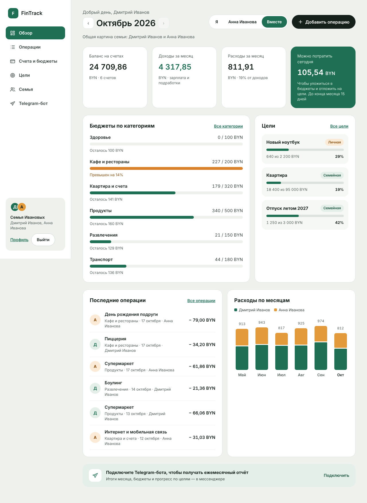
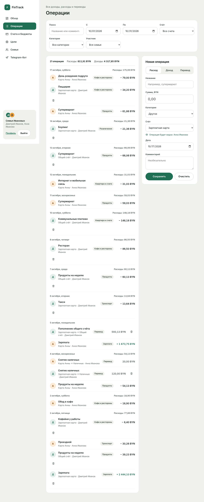
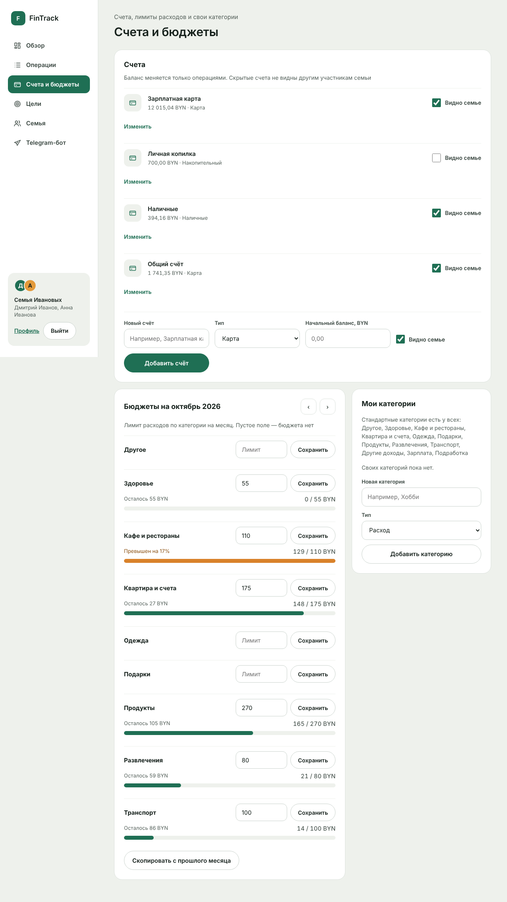
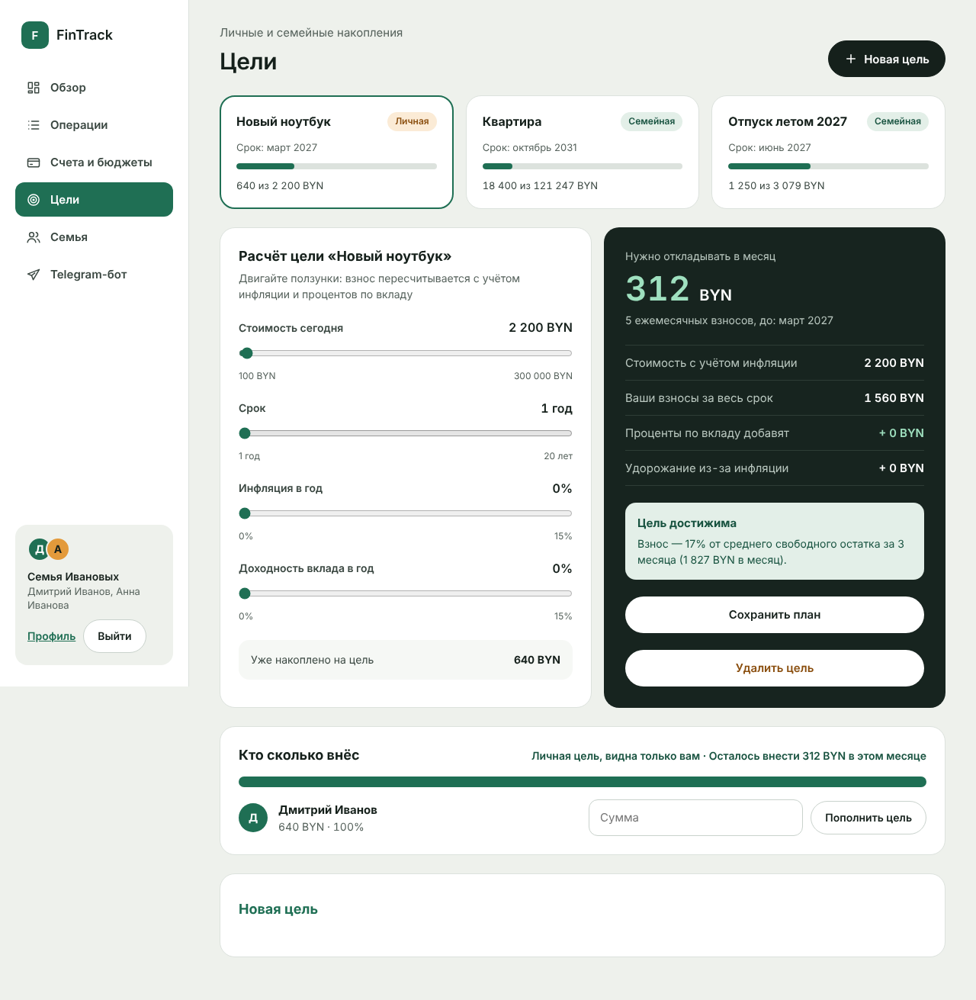
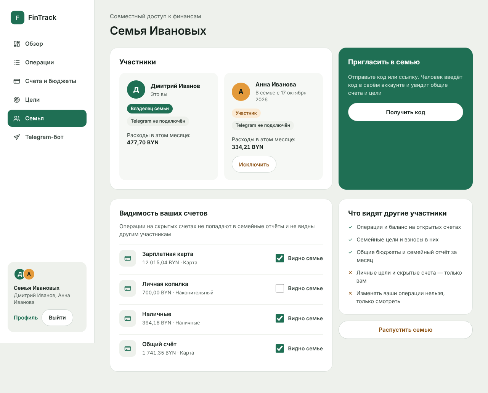
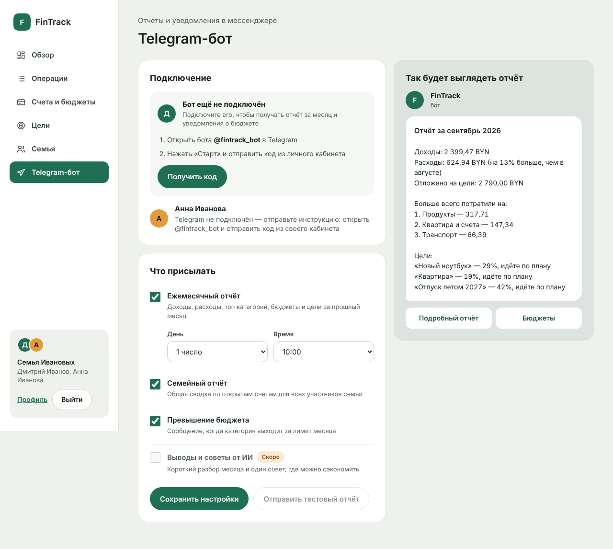
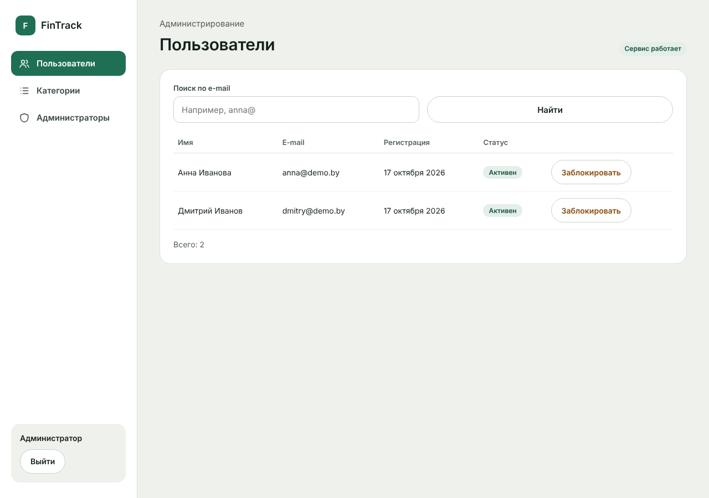

# FinTrack – Personal and Family Finance Tracker

FinTrack is a web application with a Telegram bot for tracking and planning personal and family finances.



## Features

- **Accounts and transactions** – incomes, expenses and transfers between your own accounts; account balances are recalculated in the same DB transaction as the operation.
- **Budgets** – monthly limits per expense category, copy limits from the previous month, "can spend today" amount on the dashboard.
- **Family** – invite family members with a one-time code (valid 24 h). Members see each other's shared accounts, but can change only their own data. Hidden accounts stay private.
- **Goals** – personal and family goals; the monthly contribution is calculated with inflation and deposit interest, plus a realism check against your average free cash.
- **Telegram bot** – monthly report (sent in the user's time zone), budget overrun notifications, `/balance` and `/today` commands.
- **Admin panel** – users (search, block/unblock), standard categories, administrators, service health.

## Tech stack

- Java 21, Spring Boot 4 (Web MVC, Security, Data JPA, Validation, Actuator)
- PostgreSQL 17, Flyway migrations, Hibernate; H2 for tests
- Thymeleaf templates, plain CSS and a bit of vanilla JS
- TelegramBots 9 (long polling)
- JUnit, Mockito, AssertJ, MockMvc
- Docker, Docker Compose

## Running

Copy `.env.example` to `.env` and fill in `DB_PASSWORD` and `ADMIN_PASSWORD` (at least 8 characters).

**Everything in Docker:**

```bash
docker compose up --build
```

The app starts on http://localhost:8080.

**With demo data** (the Ivanov family, half a year of operations, budgets and goals):

```bash
SPRING_PROFILES_ACTIVE=prod,demo docker compose up --build
```

Demo data is created only once. To start from an empty database run `docker compose down -v`.

**Development:** start only the database and run the app from the IDE with the `dev` profile
(PostgreSQL on `localhost:5433`, user/password `fintrack` by default):

```bash
docker compose up -d db
./mvnw spring-boot:run -Dspring-boot.run.profiles=dev
```

### Demo accounts

| Who | E-mail | Password |
|---|---|---|
| Dmitry Ivanov (family owner) | `dmitry@demo.by` | `demo12345` |
| Anna Ivanova (family member) | `anna@demo.by` | `demo12345` |
| Administrator | `ADMIN_EMAIL` from `.env` (default `admin@fintrack.local`) | `ADMIN_PASSWORD` from `.env` |

## Telegram bot

The bot is disabled by default – the app works without it and messages are written to the log.

1. Create a bot with [@BotFather](https://t.me/BotFather) (`/newbot`) and copy the token.
2. Set in `.env`: `TELEGRAM_BOT_ENABLED=true`, `TELEGRAM_BOT_TOKEN=...`, `TELEGRAM_BOT_USERNAME=...` (without @).
3. Restart the app.
4. Optionally send `/setcommands` to @BotFather:
   ```text
   start - link account with a code
   balance - account balances
   today - today's expenses and daily limit
   stop - unlink the bot
   ```
5. On the site open "Telegram-бот" → "Получить код" and send the code to the bot.

## Project structure

```text
com.fintrack
├── config       security, bot, scheduler, Clock bean, first admin, demo data
├── controller   MVC controllers (admin/ – admin panel)
├── dto          forms with validation and view records
├── entity       JPA entities and enums
├── repository   Spring Data repositories (aggregates are calculated in the DB)
├── service      business logic (calc/ – pure calculations: goals, daily limit)
├── security     UserDetails and login
├── exception    exceptions and global handler
├── telegram     bot, commands, report text, scheduler
├── event        "transaction created" event
└── util         money/date formatting, plurals
```

## Tests

```bash
./mvnw clean verify
```

Tests use an in-memory H2 database (`test` profile), Docker is not needed. Covered: registration and security rules,
balances for all operation types, access to other users' data (404), family invites, budgets, goal calculations,
Telegram linking and commands, report scheduler, budget notifications, admin panel, demo data.

## Notes

- One currency per user; amounts of family members are summed without conversion.
- A goal contribution is stored separately and does not change account balances.

## Screenshots

| | |
|---|---|
|  |  |
|  |  |
|  |  |
